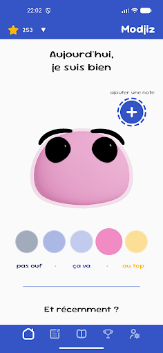
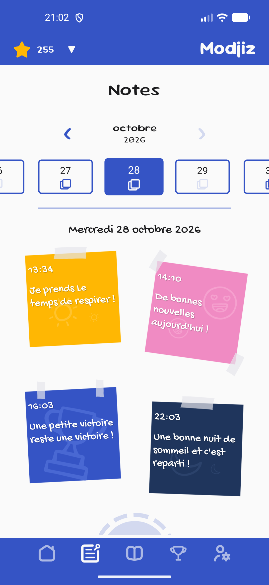

# Modjiz

Application de suivi d’humeur développée avec Next.js permettant d’analyser ses émotions dans le temps à travers des statistiques, de la visualisation et de la gamification.

## 🚀 Aperçu

  
  &nbsp;&nbsp;
  

## 📌 Fonctionnalités

- 😊 enregistrement de l’émotion quotidienne
- 🎭 mascotte 3D dynamique représentant l’humeur
- 📝 création de notes sous forme de post-it
- 📊 tableau de statistiques mensuelles et annuelles
- 📈 moyennes, tendances et comparaisons
- 🏆 système de gamification (trophées)
- ⚡ mise à jour instantanée des données
- 👤 Comptes utilisateurs (inscription / connexion)
- 🔒 Authentification sécurisée avec Supabase
- 🔑 Réinitialisation du mot de passe par e-mail
- ☁️ Synchronisation et sauvegarde des données en base de données

## 🛠️ Technologies utilisées

### Frontend

- React
- Next.js
- Three.js

### Backend & données

- Supabase
- PostgreSQL
- API Routes Next.js

### Sécurité

- Supabase Auth
- Cloudflare Turnstile

## ⚙️ Fonctionnement

- l’utilisateur peut créer un compte ou utiliser la version démo
- l’utilisateur enregistre son humeur du jour
- une mascotte 3D reflète visuellement l’émotion
- les données sont stockées temporairement (sessionStorage)
- l’application calcule des statistiques (mensuelles / annuelles)
- une page dédiée permet de visualiser les tendances et comparaisons
- des trophées sont débloqués selon l’activité utilisateur

## 🧱 Architecture

- architecture fullstack basée sur Next.js
- séparation des composants UI / logique métier
- gestion d’état côté client
- API interne via routes Next.js
- authentification centralisée avec Supabase
- coexistence des modes démo et réel
- structure pensée pour une future évolution mobile

## 🎯 Objectifs du projet

Ce projet m’a permis de :

- concevoir une application centrée utilisateur (UX + émotion)
- manipuler et analyser des données temporelles
- implémenter des logiques de gamification
- mettre en place une authentification complète
- intégrer une base de données relationnelle
- construire une architecture fullstack évolutive

## 🎯 Ce que j’ai appris

- gestion d’état et rendu dynamique avec React / Next.js
- manipulation de données statistiques
- conception d’une UX engageante
- intégration de logique de gamification
- authentification et gestion des sessions
- intégration de Supabase
- sécurisation des flux utilisateurs (CAPTCHA, récupération de mot de passe)
- structuration d’un projet évolutif

## 🚧 Roadmap

### 🔹 V1 — Prototype

- frontend fonctionnel
- données mockées (sessionStorage)
- stats
- gamification

### 🔹 V2 — Comptes utilisateurs & persistance

- authentification complète
- base de données Supabase
- sauvegarde des données
- synchronisation multi-device
- récupération de mot de passe

### 🔹 V3 — Application mobile

- développement en React Native
- synchronisation avec le backend
- amélioration UX mobile

## 🚧 État du projet

Modjiz est actuellement disponible sur Android (phase V3). L’application permet de suivre son humeur au quotidien, de consulter ses statistiques et de retrouver ses données grâce à la synchronisation avec Supabase.

Version logicielle : 1.3.0

✅ Fonctionnalités disponibles

- enregistrement de l’humeur quotidienne
- visualisation des statistiques et des tendances
- authentification et sauvegarde des données avec Supabase
- mascotte représentant l’humeur
- système de trophées
- prise de notes avec la fonctionnalité Post-it

🔧 Améliorations en cours

- ajustements de l’interface et de la navigation
- nettoyage et restructuration progressive du code
- réflexion sur l’évolution du système de trophées

🎯 Prochaines étapes

- améliorer la maintenabilité du code
- faire évoluer la page des trophées et ses objectifs
- continuer à améliorer l’expérience utilisateur à partir des retours

## 👨‍💻 Auteur

CHARVOT Marc
GitHub : https://github.com/PYXHD
